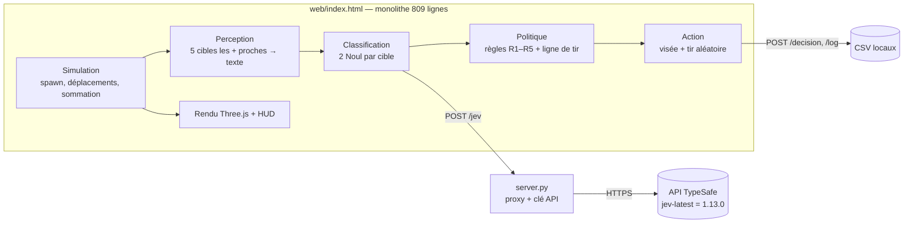

# Audit — Dernier Abri / Last Shelter (JEV v2.2)

> Date : 15/10/2026 · Périmètre : `server.py` (183 lignes), `web/index.html` (809 lignes), données `decisions_jev.csv` (72 décisions, vrai JEV, EN) et `resultats_parties.csv`.
> Dossiers voisins (`jev-zombies` 2D, `jev-consommation`) : prototypes antérieurs, hors refactorisation.

---

## 1. État des lieux

### 1.1 Architecture actuelle



| Couche | Où | Rôle |
|---|---|---|
| Simulation | `index.html` (classe `Perso`, `frame()`) | Vérité terrain (`nature`), mouvement, réaction à la sommation |
| Perception | `visibles()` | 5 cibles les plus proches < 60 m → description **textuelle** |
| Analyse | `classerJEV()` | 2 questions **Noul** opposées par cible → `pZ = (z + 1 − h) / 2`, `incoh = |z − (1 − h)|` |
| Décision | `protocole()` | Règles déterministes R1–R5 + `ligneDegagee()` + priorité au temps d'impact |
| Réponse | `tirer()` | Visée tête + anticipation, touche si `random < chanceTouche(d)` |
| Proxy | `server.py` | Cache la clé, retries 429/5xx, mode `--fake`, journalisation CSV |

### 1.2 Algorithmes / modèles
- **JEV** (TypeSafe « System One ») : modèle de décision non génératif, 2 Noul par cible, **toujours en lot** (≤ 5 cibles = ≤ 10 questions par appel).
- **Ensemble à 2 formulations opposées** : mesure de cohérence (proxy d'incertitude).
- **Collecte active d'information** : sommation → nouvelle observation → reclassification.
- **Politique** : seuils fixes (`seuil = 0.85`, `incoh ≤ 0.15`), aucun modèle de coût.

### 1.3 Ce que disent tes données (vrai JEV, 72 cibles)

| Nature | n | p(zombie) avant sommation | p(zombie) final | Issue |
|---|---|---|---|---|
| zombie | 40 | 0.76 | **0.96–0.97** | 39 abattus, **1 morsure** |
| zombie blessé | 8 | 0.72 | **0.80–0.94** | 6 abattus, **2 morsures** |
| humain | 21 | 0.39 | **0.04–0.07** | 21 sauvés ✅ |
| humain blessé | 3 | — | 0.04 | 3 sauvés ✅ |

- ✅ **0 humain abattu** : la sommation sépare parfaitement les classes (écart de 0.73 entre le pire zombie et le pire humain).
- ❌ **2 morsures = zombies blessés restés « incertains »** : p = 0.84 et 0.80, juste **sous le seuil 0.85**. Leur réaction (« tourne la tête puis continue ») est ambiguë et le seuil est trop strict par rapport aux données.
- ❌ **1 morsure de zombie confirmé (p = 0.97)** : pas un problème de classification, mais de **tir** (temps de recharge, ratés, ligne de tir bloquée).
- ❌ **Précision au tir : 52 %** (45 touchés / 86 tirs) et **15 tirs bloqués**. Le goulot d'étranglement est maintenant **l'exécution**, pas l'IA.

### 1.4 Vulnérabilités et limites

| # | Sévérité | Problème | Où | Correctif |
|---|---|---|---|---|
| S1 | 🔴 Haute | **CSRF sur `/jev`** : n'importe quel site ouvert dans ton navigateur peut envoyer une requête « simple » (`text/plain`, `no-cors`) à `localhost:8000/jev` → **utilise la clé du prof**. Le serveur ne vérifie ni `Content-Type` ni `Origin`. | `do_POST` | Exiger `Content-Type: application/json` + `Origin`/`Host` = localhost + jeton de session aléatoire injecté dans la page |
| S2 | 🟠 Moyenne | **Pas de budget d'appels** : un bug en boucle peut vider le crédit (aucun plafond appels/min ni tokens/session) | `server.py` | Limiteur *token bucket* + plafond de tokens par session |
| S3 | 🟠 Moyenne | **Injection CSV** (`=`, `+`, `-`, `@` en début de champ → formule exécutée dans Excel) et **colonnes libres** (le client choisit les clés) | `/log`, `/decision` | Liste blanche des champs + échappement |
| S4 | 🟡 Basse | `Content-Length` non borné → saturation mémoire | `do_POST` | Limite à 64 Ko |
| S5 | 🟡 Basse | **Injection de prompt** (pour un usage réel) : si les descriptions viennent d'une source externe (logs, OCR…), un texte peut contenir des consignes | conception | Entrées toujours dans `state` (données), décision finale **dans le code**, jamais dans le modèle |
| S6 | 🟡 Basse | `.DS_Store` non ignoré | `.gitignore` | Ajouter |

| # | Limite technique | Impact |
|---|---|---|
| L1 | **Monolithe** : rendu, simulation, IA et UI dans un seul fichier | Impossible à tester, difficile à faire évoluer |
| L2 | **`fetch` sans timeout côté client** + serveur jusqu'à ~31 s (3 × 10 s + attentes) | Le cerveau JEV peut **geler 30 s** (`busy = true`) |
| L3 | **Aucune mémoire temporelle** : chaque appel repart de zéro, l'évidence n'est pas cumulée | Les blessés ambigus restent « incertains » jusqu'à la barricade |
| L4 | **Seuils figés à la main** (0.85 / 0.15), pas de modèle de coût | Morsures évitables (cf. 1.3) |
| L5 | **Pas de cache** : seulement 10 descriptions × 3 états de réaction × 2 langues = **60 entrées possibles**, mais 91 appels par partie | Latence et coût inutiles |
| L6 | Hasard **non reproductible** (`Math.random`) et horloge réelle (`setTimeout`) mélangée au temps simulé | Pas de tests, pas de comparaison A/B fiable |
| L7 | Goulot à **5 cibles analysées** + une seule requête en vol | Retard de classification des cibles lointaines |
| L8 | Politique de tir naïve : tire dès que `chance ≥ 0.5` (30 m) | 41 balles perdues, recharges au mauvais moment |

### 1.5 Faux positifs / négatifs potentiels
- **Faux positif** (humain abattu) : description humaine trompeuse **et** réaction mal lue, ou humain qui passe dans la trajectoire après la vérification de la ligne de tir (la vérification se fait à la décision, pas au moment du tir).
- **Faux négatif** (morsure) : seuil trop haut, réaction ambiguë, mauvaises chances de toucher, recharge.
- **Risque de dérive** : `jev-latest` peut changer de version (1.13 → 1.14 observé) → seuils à recalibrer. Il faut **figer la version** et la journaliser.

---

## 2. Amélioration du système actuel

### 2.1 Refactorisation modulaire (séparation détection / analyse / décision / réponse)

```
jev-zombies-3d/
├── server/                     # Python
│   ├── app.py                  # HTTP : statique + /jev + /log (sécurisé)
│   ├── jev_client.py           # appels JEV : retries, timeout, cache, budget
│   └── storage.py              # CSV sûrs (liste blanche + échappement)
├── web/
│   ├── index.html              # coquille HTML + CSS uniquement
│   └── js/
│       ├── main.js             # boucle, orchestration
│       ├── sim/                # monde simulé (vérité terrain, RNG seedé, horloge simulée)
│       ├── perception/         # entités → observations textuelles + cinématiques
│       ├── analysis/           # classifieurs (JEV, cinématique) + fusion bayésienne
│       ├── policy/             # règles d'engagement, coûts, ordonnancement des cibles
│       ├── response/           # visée, tir, journal
│       ├── render/             # Three.js (scène, persos, effets)
│       ├── ui/                 # HUD, i18n
│       └── config.js           # seuils, coûts, constantes
└── tests/                      # simulateur headless + tests unitaires
```

Contrat entre couches (aucune couche ne lit la vérité terrain sauf `sim/` et le journal) :
`Observation → Assessment {pZ, incoh, evidence[]} → Decision {action, cible, règles, justification} → Outcome`.

### 2.2 Trois améliorations pour aller beaucoup plus loin

**① Accumulation d'évidence bayésienne + test séquentiel (SPRT)**
- Chaque observation (description, réaction n°1, **2ᵉ sommation**, cinématique) met à jour le **log-odds** de la cible : `L ← L + log(p/(1−p))`.
- On ajoute un analyseur **cinématique** gratuit et instantané : un humain s'arrête après la sommation (vitesse → 0), pas un zombie. Cet indice est indépendant de JEV.
- **SPRT de Wald** : on tire quand `L ≥ log((1−β)/α)` et on déclare « humain » quand `L ≤ log(β/(1−α))`, avec α = risque de tuer un humain (ex. 0,1 %) et β = risque de morsure. Entre les deux, on **escalade** : 2ᵉ sommation, puis attente. Les erreurs sont **bornées mathématiquement** au lieu de dépendre d'un seuil choisi au doigt mouillé.
- 👉 Règle directement les 2 morsures « incertaines ».

**② Politique de décision par coût et ordonnancement dynamique**
- Avec le barème du jeu (+10 zombie, +15 humain sauvé, −50 humain abattu, −20 morsure), on tire si l'espérance de gain est positive : `p* = 65 / 95 ≈ 0,68`. Ça confirme que **0,85 est trop strict**, et tes données sont compatibles avec ~0,70, sans erreur observée (n = 72, à revalider).
- Score de menace par cible : `risque = pZ × 1 / temps_avant_impact`. On **ordonnance** les tirs pour maximiser `P(touche)` avant l'échéance : attendre que la cible approche si on a le temps, tirer tout de suite si elle arrive. On anticipe aussi les recharges (recharge tactique quand aucune cible n'est urgente).
- Vérification de la ligne de tir **au moment du tir**, pas seulement à la décision.
- 👉 Vise les 41 ratés et la morsure du zombie confirmé.

**③ Boucle de rétroaction + calibration + simulateur headless**
- `decisions_jev.csv` → **diagramme de fiabilité** (quand JEV dit 0,8, a-t-il raison 80 % du temps ?) → recalibration **isotonique** → seuils auto-ajustés.
- **Cache** des réponses JEV par `hash(description, réaction, langue, version)` : au plus 60 entrées, donc latence ≈ 0 et coût ÷ 10 environ après la 1ʳᵉ partie.
- **Simulateur headless** (Node ou Python, RNG seedé, JEV en cache ou simulé) : 1 000 parties en quelques secondes pour comparer des politiques en A/B avec intervalles de confiance.
- **Détection de dérive** : si la distribution des `pZ` change (nouvelle version de JEV), alerte et recalibration.

---

## 3. Conception générique (réutilisation)

### 3.1 Noyau : pipeline événementiel

```mermaid
flowchart LR
  subgraph Sources [Connecteurs d'entrée]
    A[GameSource<br/>WebSocket du jeu]
    B[RTSPSource<br/>caméra → détecteur → texte]
    C[LogSource<br/>fichier / syslog]
    D[MetricsSource<br/>réseau, psutil]
    E[MQTTSource<br/>capteurs IoT]
  end
  Sources --> BUS{{Bus d'événements<br/>asyncio.Queue + backpressure}}
  BUS --> N[Normaliser → Observation]
  N --> T[Tracker / corrélation<br/>Observation → Piste]
  T --> AN[Analyseurs<br/>JEV · anomalie stat. · cinématique]
  AN --> F[Fusion bayésienne<br/>log-odds + SPRT]
  F --> P[Politique<br/>règles + coûts + humain dans la boucle]
  P --> R[Réponses<br/>alerte · enregistrement · webhook · jeu]
  R --> FB[(Retour terrain<br/>calibration)]
  FB -. recalibre .-> F
```



### 3.2 Interfaces (Python, `typing.Protocol`)

```python
@dataclass(frozen=True)
class Observation:          # unité normalisée, quelle que soit la source
    source: str             # "game", "rtsp:portail", "syslog", "mqtt:porte"
    entity_id: str          # piste / IP / capteur
    ts: float
    text: str               # résumé lisible par JEV (ce qui est observé)
    features: dict[str, float]  # numériques : vitesse, octets/s, température…

class Source(Protocol):
    def stream(self) -> AsyncIterator[Observation]: ...

class Analyzer(Protocol):   # JEV, z-score EWMA, Isolation Forest, cinématique…
    name: str
    async def assess(self, track: Track) -> Evidence: ...   # log-odds + confiance

class Policy(Protocol):
    def decide(self, track: Track) -> Decision: ...         # règles explicites, auditables

class Responder(Protocol):
    async def act(self, decision: Decision) -> Outcome: ...
```

- Ajouter un connecteur = **une classe `Source`** + une entrée dans `config.yaml`, sans toucher au cœur.
- La **même politique** et les **mêmes analyseurs** tournent sur le jeu et sur des sources réelles : le jeu devient un **banc d'essai**.

### 3.3 Contrainte de conception non négociable
Pour toute source du **monde réel** (caméras, capteurs), les `Responder` autorisés sont **informatifs** : alerte, notification (Discord, mail, push), enregistrement, journal, ticket. **Aucune action physique contre des personnes** n'est implémentée ni prévue, et une **validation humaine** est requise avant toute action irréversible. Pour les métriques réseau, des réponses techniques réversibles (ex. blocage temporaire d'une IP) sont acceptables, avec journalisation.

---

## 4. Feuille de route

| Phase | Contenu | Livrable testable |
|---|---|---|
| **0. Sécuriser** | S1–S4 (CSRF, budget, CSV, taille) + timeouts client (L2) + version JEV figée | Tests du proxy |
| **1. Modulariser** | Découpage `web/js/*` en modules ES, RNG seedé + horloge simulée (L1, L6) | Le jeu identique visuellement, `?seed=42` reproductible |
| **2. Cache + headless** | Cache JEV (L5), simulateur sans rendu, script de benchmark | `python -m bench --games 500` → tableau comparatif |
| **3. Fusion + SPRT** | Amélioration ① + analyseur cinématique + 2ᵉ sommation | Morsures de blessés → ~0 sur 500 parties, 0 humain abattu |
| **4. Politique par coût** | Amélioration ② (seuil par coût, ordonnancement, vérification au tir) | Précision ↑, morsures ↓ |
| **5. Calibration** | Amélioration ③ (fiabilité, isotonique, dérive) | Notebook + diagramme de fiabilité |
| **6. Noyau générique** | Package Python `vigie/` (Source / Analyzer / Policy / Responder), `GameSource` via WebSocket | Le jeu piloté par le noyau Python |
| **7. Connecteurs réels** | `LogSource`, `MetricsSource`, puis `RTSPSource` (alerte + enregistrement uniquement) | Alerte Discord sur intrusion détectée |
