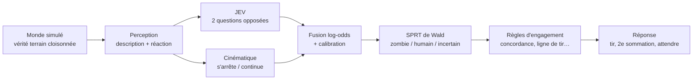

# Dernier Abri / Last Shelter

**Une IA classe, le code décide.** Jeu 3D de défense où un modèle d'IA (JEV, TypeSafe AI) estime, à partir d'une simple description textuelle, si une silhouette dans la nuit est un zombie ou un survivant, et où un code déterministe, testé et auditable décide de tirer… ou pas.

> *An AI classifies, deterministic code decides. A 3D browser game used as a test bench for decision-making under uncertainty: Bayesian evidence fusion, Wald's sequential test, calibration, drift detection, and a reusable "observe → analyse → decide → respond" core. Zero humans shot across thousands of simulated games.*


Projet du cours **Coding for AI** (L3 Data Science & IA, aivancity).

---

## L'idée en une minute

| Principe | Concrètement |
|---|---|
| **Le modèle classe, le code décide** | JEV ne renvoie que des probabilités. Le tir passe par des règles explicites, versionnées et testées. |
| **Doute ⇒ pas d'action** | Un humain abattu coûte plus cher qu'une morsure. Dans le doute : nouvelle sommation, jamais de tir. |
| **Plusieurs preuves indépendantes** | Ce que dit JEV **et** ce que fait la silhouette après « Stop ! Levez les mains ! » (s'arrête-t-elle ?). |
| **Mesurer avant d'affirmer** | Simulateur sans rendu : des milliers de parties reproductibles, comparaisons appariées, intervalles de confiance. |

## Résultats (500 parties, réponses réelles de JEV rejouées depuis un cache)

| Version | Méthode | Morsures / partie (EN) | Humains abattus |
|---|---|---|---|
| v2.2 (départ) | Seuil fixe sur la probabilité de JEV | 4,31 | 0 |
| v3 | Fusion bayésienne (log-odds) + test séquentiel de Wald (SPRT) + mesure du mouvement | **1,25** | 0 |
| v4 | + ordonnancement des tirs (tir d'opportunité, rechargement tactique, verrou au tir) | 0,95 (gain réel ≈ −11 % sur graines jamais vues) | 0 |
| v5 (défaut) | + probabilités JEV calibrées (Platt) | 0,95 (identique), **marge de sécurité ×3,5** | 0 |

- **0 humain abattu** sur toutes les évaluations, y compris un stress test où 50 % des humains paniquent et n'obéissent pas.
- **Calibration** : l'isotonique avait les meilleures métriques… mais, hors échantillon, elle cassait la décision (4,2 morsures/partie). Leçon : *une meilleure calibration n'est pas une meilleure décision*. Détails : [`analyse/calibration.ipynb`](analyse/calibration.ipynb).
- **Bruit de JEV mesuré** (80 appels) : écart-type ≈ 0,01 par question. Les seuils de détection de dérive sont calés dessus.
- **Noyau générique `vigie/`** (Python) : piloté en WebSocket, il rejoue 130 parties **à l'identique** de la version JavaScript.


## Architecture



- **Navigateur** (`web/`) : Three.js, modules ES natifs, horloge simulée et graine aléatoire ⇒ parties reproductibles (`?seed=42`).
- **Serveur** (`server/`, Python stdlib) : proxy local qui garde la clé API, cache des réponses JEV, budget d'appels, protections CSRF / DNS rebinding.
- **Noyau** (`vigie/`, Python stdlib) : la même politique, réutilisable sur d'autres sources ; règle codée en dur : *source du monde réel ⇒ réponses informatives uniquement* (alerte, journal), jamais d'action.

## Lancer le jeu

Prérequis : Python ≥ 3.10 et un navigateur récent. Aucune dépendance obligatoire.

```bash
git clone <ce dépôt> && cd jev-zombies-3d
python3 server.py --fake        # JEV simulé : aucune clé, aucun coût
```

Puis ouvrir http://localhost:8000. Touches : `1` JEV, `3` bot naïf, `4` manuel, `L` FR/EN.

**Avec le vrai JEV** : copier `.env.example` en `.env` et y mettre **votre** clé TypeSafe (`TYPESAFE_API_KEY=...`). La clé reste côté serveur : jamais dans le navigateur, les journaux ni le dépôt.

## Tests et benchmark

```bash
python3 -m unittest discover tests        # proxy, cache, calibration, noyau, WebSocket…
node --test tests/js/                     # politique, fusion, sécurité pire cas, simulateur
node tests/bench.mjs --parties 500 --jev fake --langue en   # benchmark headless
```

Le benchmark avec les vraies réponses de JEV (`--jev cache`) nécessite un cache rempli une fois avec une clé (`python3 -m server.remplir_cache`).

## Structure

```
web/js/      sim/ perception/ analysis/ policy/ response/ render/ ui/   (le jeu)
server/      proxy sécurisé, client JEV, cache, détection de dérive, WebSocket
vigie/       noyau générique : fusion, SPRT/CUSUM, analyseurs, répondeurs
analyse/     calibration (notebook), étude du bruit de JEV
tests/       tests Python et JS, simulateur headless, benchmark
```

## Limites (honnêtement)

- Les résultats valent **dans le monde simulé** : 50 descriptions textuelles connues, des comportements modélisés. Un usage réel exigerait de tout re-mesurer sur de vraies données.
- La calibration repose sur 24 fiches cohérentes : peu d'observations indépendantes, d'où la validation croisée par description.
- C'est un jeu et un banc d'essai pédagogique sur la **décision sous incertitude**, pas un système d'armes.

## Crédits

- Modèle **JEV** : TypeSafe AI (accès fourni dans le cadre du cours).
- Rendu 3D : [Three.js](https://threejs.org).
- Cours *Coding for AI*, aivancity.

## Licence

[MIT](LICENSE)
